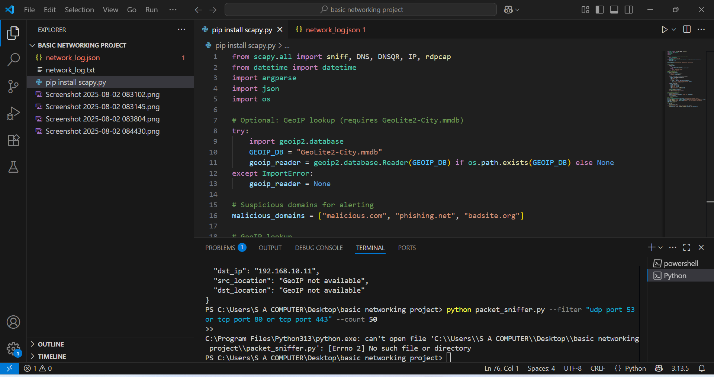
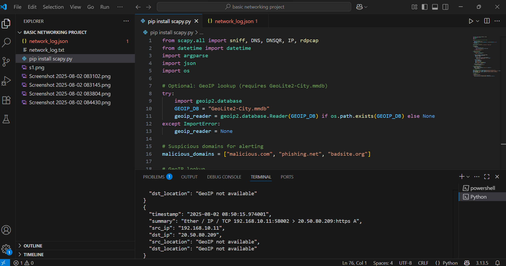
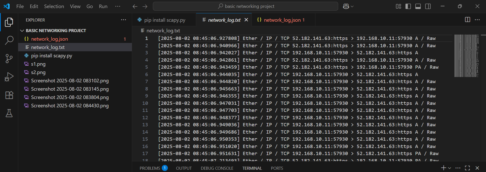
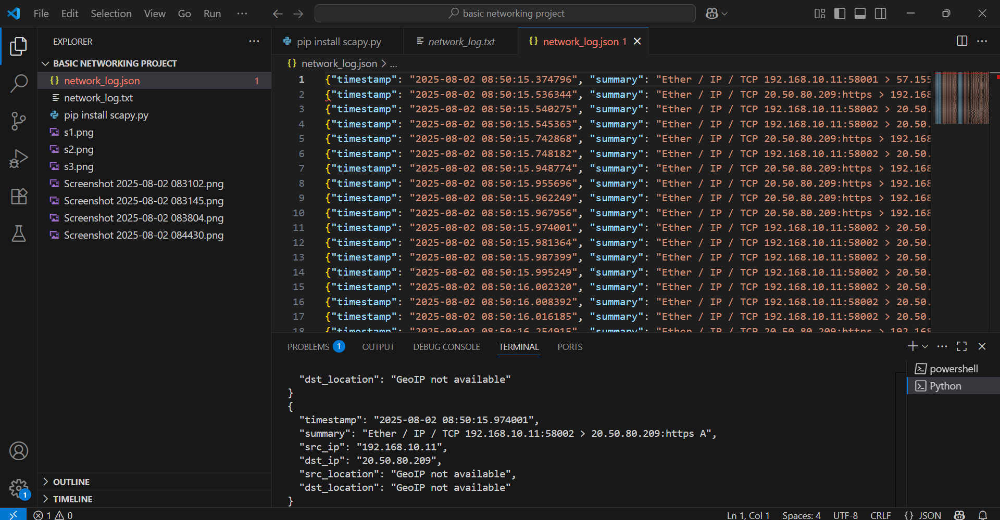

# Packet Sniffer and Analyzer with GUI

A Python/Tkinter application for live network packet capture and analysis. It provides protocol and BPF filtering, blacklist alerting, optional GeoIP enrichment, structured JSONL logging, graphical traffic summaries, and CSV/JSON export.

**Author:** Rahul Kumar (BSCSY015)  
**License:** MIT

## Features

- **Multi-threaded capture** — Scapy capture runs in a background thread; the Tkinter interface stays responsive through a thread-safe event queue.
- **Flexible filtering** — BPF presets for TCP, UDP, ICMP, ARP and DNS, plus a free-form BPF filter field that can be combined with the preset.
- **Blacklist alerting** — editable domain and IP blocklists; suspicious DNS queries and blocklisted addresses raise visible alerts and are written to a separate alert log.
- **Protocol inspection** — identifies TCP, UDP, ICMP, ARP and DNS traffic, with source/destination addresses, ports, packet length and HTTP request lines where available.
- **Optional GeoIP lookup** — uses a local MaxMind GeoLite2 City database when present, with a graceful fallback for private or unknown addresses.
- **Traffic analytics** — live session statistics and a matplotlib bar-chart summary of protocol distribution and top source addresses.
- **Structured logs** — newline-delimited JSON for all packets and for alerts, stored under `logs/`.
- **Exports** — CSV and JSON export of captured records, plus date-based log filtering.
- **Admin gate** — password-protected startup with a configurable password hash and an administrator/root privilege notice.

## Screenshots

| | |
|---|---|
|  |  |
|  |  |

Additional screenshots are available in the repository root (`s5.png`–`s13.png` and the `Screenshot 2025-08-02 *.png` files). The full project report is included as `Cybersecurity_Packet_Sniffer_Report_BSCSY015.pdf`.

## Requirements

- Python 3.9 or newer
- [Scapy](https://scapy.net/) and [matplotlib](https://matplotlib.org/)
- Administrator/root privileges for raw packet capture (Npcap on Windows, libpcap on Linux/macOS)
- Optional: `geoip2` and a MaxMind GeoLite2 City database

Install the core dependencies:

```bash
pip install -r requirements.txt
```

For GeoIP support:

```bash
pip install -r requirements-geoip.txt
```

## Configuration

All configuration lives in `config/` and is ignored by Git except for the example files.

1. **Admin password** — set an environment variable before starting:

   ```bash
   # Windows PowerShell
   $env:PACKET_SNIFFER_ADMIN_PASSWORD = "choose-a-strong-password"
   python packet_sniffer_gui.py
   ```

   Alternatively, copy `config/settings.example.json` to `config/settings.json` and store a SHA-256 hash of your password:

   ```bash
   python -c "import hashlib; print(hashlib.sha256(b'choose-a-strong-password').hexdigest())"
   ```

   If no password is configured, the app generates a one-time random password and prints it to the terminal on startup.

2. **Blacklists** — copy `config/blacklists.example.json` to `config/blacklists.json` and edit the domains/IPs, or use the **Edit blacklists** button in the application. Changes are saved automatically.

3. **GeoIP (optional)** — place `GeoLite2-City.mmdb` in the project root, or set `geoip_db_path` in `config/settings.json` to an absolute path.

## Usage

```bash
python packet_sniffer_gui.py
```

1. Enter the admin password at the login prompt.
2. Choose a protocol preset and, optionally, enter a custom BPF filter (for example `host 8.8.8.8`).
3. Set an optional packet limit (`0` means unlimited).
4. Click **Start capture** and watch the live log and statistics.
5. Use **View alerts**, **Traffic summary**, **Export CSV/JSON**, **Edit blacklists**, **Filter by date** or **Clear logs** as needed.
6. Click **Stop capture** before closing the window.

Logs are written to `logs/network_log.jsonl` and `logs/alerts.jsonl`. Exported files can be saved anywhere you choose through the file dialog.

## Project structure

```text
cybersecurity-packet-sniffer/
├── packet_sniffer_gui.py          # Application entry point and GUI
├── config/
│   ├── blacklists.example.json    # Example blocklist
│   └── settings.example.json      # Example password hash / GeoIP path
├── logs/                          # Generated JSONL logs (Git-ignored)
├── requirements.txt               # Core dependencies
├── requirements-geoip.txt         # Optional GeoIP dependency
├── LICENSE
└── README.md
```

## Ethical use

This tool is intended for authorised security testing, teaching and personal lab use only. Capture traffic only on networks you own or have explicit written permission to monitor, and handle captured data responsibly.

## License

Released under the MIT License. See `LICENSE` for details.
